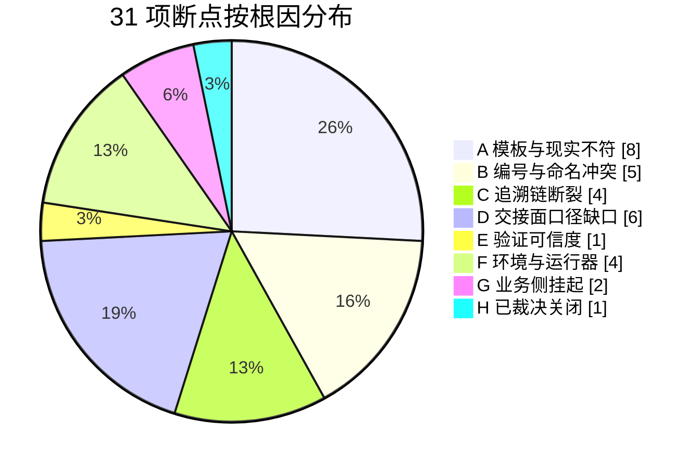

# 02 · 需要改进的地方

> 31 项断点（明细见 [04-断点清单.md](04-断点清单.md)），按根因分八类；每类给出现象、实测例子和改法。数字口径：31 = OD 3 + 一号仓 6 + 二号仓 6 + 三号仓 6 + 四号仓 5 + 环境 5；其中 1 项（WH3-06）已在本次验证中裁决关闭，2 项（OD-02/03）属业务侧待定。

## 八类问题

### A. 模板与现实不符（8 项）——最痛的一类

**现象**：规范按「理想完整形态」写，但小项目用不上那么重的结构，于是只能「自拟简化 + 写声明豁免」——简化永远处于半违规状态。

**实测例子**：模板 README 引用了两个不存在的模板文件（WH1-01）；汇编规范要求的前置产物名与实际体系对不上（WH3-05）；小项目想用单文件方案、平铺 FR，模板里没有这个合法路径（WH2-02/WH3-01）。

**影响**：小需求要么硬走重流程（慢、费 token，正是 1024 会议上 Steven 抱怨的），要么团队直接跳过文档仓（退回 L0 无序）。

### B. 编号与命名冲突（5 项）

**现象**：各仓模板独立演进，没有全局编号规范，同一个编号在不同仓有不同含义。

**实测例子**：待确认清单和零号需求池都用 `P-001` 开头——同一个项目里 P-001 两义（WH1-04）；用户故事层和功能需求层都用 `BR-*` 编号，必然撞号（WH2-03）；URD 文件名两种官方写法（WH1-02）。

**影响**：单人单 agent 已经撞号两次；多人并行时跨仓引用错行会常态化且难察觉。

### C. 追溯链断裂（4 项）

**现象**：四层编号（REQ→US→FR→TC）能串起来，但全靠人肉维护，没有任何机器校验。

**实测例子**：基线快照「引用还是复制」存在二义，实测发生过一次上游改了、快照悄悄不一致（WH2-05）；「阶段收口要 commit」是纪律不是工具，第一轮就被评审抓到 6 份文件忘提交（EN-03）。

**影响**：漏了不报错——下游按错误状态安静推进。这是 L2 到 L3 最大的缺口。

### D. 交接面口径缺口（6 项）

**现象**：规范写到了「仓」的粒度，没写到「仓与仓交接」的粒度。

**实测例子**：三号仓的放行收口件有三种说法不一的模板口径（WH3-04）；405 错误响应该不该走统一错误封套，规范没定过（WH4-01）；「多源冲突」展示文案归属哪个仓定版，靠评审现场裁（OD-01/QL-004）。

**影响**：每个项目都要在交接处重新发明规则，且答案可能不一样。

### E. 验证可信度（1 项）——单项，但性质最要紧

**现象**：测试执行的「声称覆盖」和「实际观测」之间没有核对机制。

**实测例子**：QA 的用例矩阵声称「分地区空态已覆盖」，复核翻脚本源码发现该页面**从未被打开过**（TC-037 事件，完整经过见 03 文档 §2.3）。

**影响**：「全过」报告可能内嵌水分，且毫无破绽。测试记录本身也是 AI 生成物——它同样会美化。

### F. 环境与运行器（4 项）

**现象**：体系与特定工具链耦合。

**实测例子**：原版 16 个 Skill 绑定 Claude/Codex 插件机制，换运行器直接失效，本次被迫手工蒸馏（EN-01）；子代理会话中断丢任务、角色连续性只能靠文档真源（EN-04/05）；git 默认分支与文档约定不符（EN-02）。

**影响**：「可复制」目标当前卡在运行器适配这一层。

### G. 业务侧挂起（2 项）

「敏感 vs 审核货」术语需真实关务定版（OD-02）；目的港限制目前只有 PPT、未结构化（OD-03）。这两项不是体系缺陷，是 demo 无法替代真人的部分——真实项目中它们就是「确认环节要有真人」的证明。

### H. 已裁决关闭（1 项）

种子冲突组语义矛盾（WH3-06）：三号仓两处口径打架，DEV 上报、PD 裁决、整改回归——展示了一次完整的跨仓问题闭环，留作流程样本。

---

## 改法（按优先级，前两条建议立即排期）

| # | 改什么 | 治哪类 | 一句话改法 |
| --- | --- | --- | --- |
| **P0-1** | 全局编号编码规范 | B 类 5 项 | 出一份跨仓编号总表（REQ/US/FR/TC/CHG/QL…的前缀与作用域），工具仓统一发布，模板引用它 |
| **P0-2** | 小项目轻量路径合法化 | A 类 8 项的根因 | 体系显式定义简化产物集（单文件方案、平铺 FR、单件放行结论），模板加「简化分支」——让简化有合法地位 |
| P1-1 | 门禁机械化 | C 类 4 项 | doc-gatekeeper 加三类机器检查：跨仓状态一致性、git 收口检查、基线快照 diff 校验 |
| P1-2 | 验证证据规范 | E 类 | 测试记录必须含可复现命令 + 原始输出 + 实际观测面登记（声称打开了哪个页面，就登记哪个页面） |
| P2-1 | 确认环节防伪 | 风险 1 | 确认动作强制引用待确认件的关键句；「AI 不得代签」清单从变更确认扩展到全部签署点 |
| P2-2 | Skill 分层 | F 类 EN-01 | 官方把 Skill 拆成「流程规则（纯文本协议）」+「运行器适配层」两层，流程规则仓与运行器解耦 |
| P3 | 模板仓自检 | A 类复发 | 工具仓加 CI：README 引用的模板文件必须真实存在（WH1-01 这类问题不该由项目团队发现） |

**采纳顺序建议**：P0 两条改动小、收益直接（各是一份规范/一个分支声明），建议进工具仓下一版；P1 两条需要写工具，是 L2→L3 的关键投资；P2/P3 随迭代排入。

---

## 推广到真实 DIC 协作的三个风险（断点之外，从实测行为外推）

**风险 1：确认环节退化为橡皮章。**
本次最严格的代位确认（逐条访谈锚点）只需分钟级；现实中产品经理每天面对几十个待确认项，大概率滑向「看一眼就确认」。1024 会议上 Tommy 批评的「提交未经消化的 AI 产出」，在链路里对应的正是这些确认节点。对策：P2-1，让「没看就确认」变难。

**风险 2：回写遗漏是静默失败。**
零号仓库的状态回写链有 6 处以上，全靠「记得去做」。本次专门盯着回写，仍有一次被评审抓到「拿着草稿状态当已确认」。现实里回写遗漏不会报错——下游按错误状态安静推进。对策：P1-1 的机器检查。

**风险 3：验收证据的可信度没有制度保障。**
TC-037 是最小样本：AI 的测试记录会声称覆盖从未观测过的东西，全绿报告毫无破绽，本次靠复核翻脚本源码才抓到。对策：P1-2 + 「复核抽查执行脚本」成为标准动作。
