# AI 工程化跑通验证报告 · 敏货看台

**项目编号** DIC-TEST-2026-001 ｜ **日期** 2026-10-28 ｜ **报告版本** 终版

> **定位声明（先读这个）**：敏货看台是一个 **DEMO 测试项目**，不是真实业务系统。业务命题来自真实访谈（敏货查询线 B），但全部数据为虚构样例（22 个品类均带「样例」标注，不引用任何真实企业清单），不接入任何真实信源或生产环境。它存在的唯一目的，是作为载体验证 [DIC-PM-AI-Engineering](https://github.com/rosetta-guo-fyaic/DIC-PM-AI-Engineering) 工程化体系能否从立项跑到发布——本报告汇报的是**流程验证结果**，不是业务成果。

**验证任务来源**：1024-评估共建会议——「各团队亲手搭小系统跑通工程化，基于真实动手过程提取优化意见，禁止框架性空谈」。
**责任边界**（沿用会议共识）：只回答「流程、工具链、输出质量是否可控」，不评价产品商业价值。

---

## 0. 摘要

**结论：链路全程跑通，体系可用；直接推广会踩三类坑（见第 6 章），31 项断点已定位并有改法（见第 5 章）。**

用一个 DEMO 小系统（网页 + 接口 + 数据库三层的敏感货可接性看板）完整走了七段流程：OD 工作区 → 零号 → 一号 → 二号 → 三号 → 代码仓 → 四号，无跳段，每段有收口提交与评审留痕，最终 v1.0.0 发布上 GitHub（双仓 tag）。

| 关键数字 | 结果 |
| --- | --- |
| 走完的阶段 | 7 段全链路，4 道评审门禁全部执行 |
| 产物规模 | 127 份文档（约 1.5 万行）+ 可运行系统（后端 2,342 行 Python + 前端 1,008 行） |
| 质量结果 | 自动化测试 61 项 + 冒烟 26 项全过；QA 独立验收 38 用例全过；0 产品缺陷 |
| 评审实效 | 4 轮评审抓出 10 项产出方自己发现不了的缺陷，全部闭环（4.1 节） |
| 体系断点 | 31 项登记，按 8 类归因，附 7 条按优先级排序的改法（第 5 章） |
| 产出方式 | 100% 由 AI 角色生成（含本报告）；真人只下达任务，未参与任何写作 |

---

## 1. 这次验证是怎么做的

### 1.1 载体：一个刻意保持「真而小」的 DEMO

需求取自真实访谈材料（`AIC-000/.../敏货查询/` 共 7 份）：海外二部在询报价环节缺乏敏货可接性判断，需要把散落五类信源的规则做成「看现状、分地区、查变化」的看板。DEMO 实现了其中可离线闭环的部分：规则库 + 三个视图 + 简版维护 + 品名查询。**范围外的部分**（自动采集、群播报、判定推理等）在需求池逐条登记了排除原因——范围锁死、不允许悄悄扩，这本身就是按工程化规范执行的。

### 1.2 角色：五个 agent 分工，一条铁律

主控 agent 扮 OD（数字智慧中心）负责方法论与协调，四个独立子代理分别扮产品经理（PM）、研发（DEV）、测试（QA）、产品总监（PD）。铁律：**每个仓库的正文由对应角色产出，评审角色只挑毛病不代写，所有往来必须留痕到仓库。**

### 1.3 全链路流程


系统本身是标准三层网页应用：

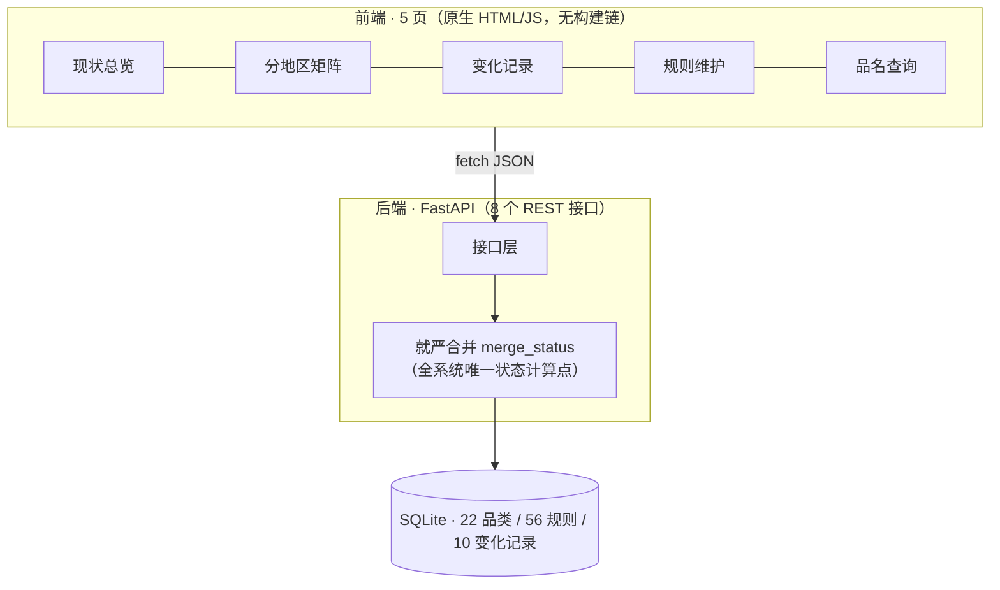

### 1.4 执行中的一个前置发现

工具仓原版 16 个 Skill 绑定了 Claude/Codex 特有的插件机制，换一个 AI 运行器就无法执行。本次剥掉运行器耦合、保留流程规则，蒸馏为 10 个通用 Skill（在[报告仓 `workspace/skills/`](https://github.com/rosetta-guo-fyaic/minhuo-kantai-report/tree/main/workspace/skills)公开），子代理靠它们执行了全程。这本身就是断点 EN-01：体系的「可复制」目标当前卡在运行器适配上。

---

## 2. 产物（全部公开在 GitHub）

| 仓库 | 是什么 | 版本锚点 |
| --- | --- | --- |
| [minhuo-kantai-doc](https://github.com/rosetta-guo-fyaic/minhuo-kantai-doc) | 项目文档仓：OD + 零~四号仓库全部正文、评审留痕、放行签署 | tag `baseline/v1.0.0` |
| [minhuo-kantai-code](https://github.com/rosetta-guo-fyaic/minhuo-kantai-code) | 项目代码仓：研发输入汇编、前后端源码、测试套件、种子数据 | tag `release/v1.0.0` |
| [minhuo-kantai-report](https://github.com/rosetta-guo-fyaic/minhuo-kantai-report) | 本报告 + 断点清单 + 35 张截图 + workspace（测试总控纪律 + 10 个蒸馏 Skill） | — |
| [DIC-PM-AI-Engineering](https://github.com/rosetta-guo-fyaic/DIC-PM-AI-Engineering) | 被验证的工程化体系（工具仓，全程只读） | — |

本地复现：克隆 code 仓后 `bash scripts/init_db.sh && bash scripts/dev.sh`，浏览器开 `http://127.0.0.1:8000`。

### 2.1 GitHub 截图与说明

**① 文档仓首页**——看两点：左侧目录就是工程化体系的结构（OD 工作区 + 零~四号仓库六个分区原样落地，没有另起炉灶）；「16 commits」对应 16 次阶段收口，每次提交信息带角色署名（谁产出的、经哪轮评审，截图③可见）。

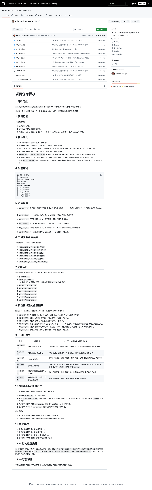

**② 基线冻结的 tag**——看 tag 提交信息：不是光秃秃的版本号，而是载着 PD 评审结论原文（「有条件放行→条件完成放行｜范围 REQ-001~005→FR-001~009｜快照 21 件 diff 一致」）。这是评审时定下的规矩：**冻结时刻必须留下可核验的锚点**，任何人翻 Releases 都能核对当时凭什么放行。


**③ 文档仓提交历史**——看提交信息格式：每条都是「仓库: 内容（角色）」，从立项到发布的状态流转顺着提交记录即可复盘，不依赖任何人的记忆。

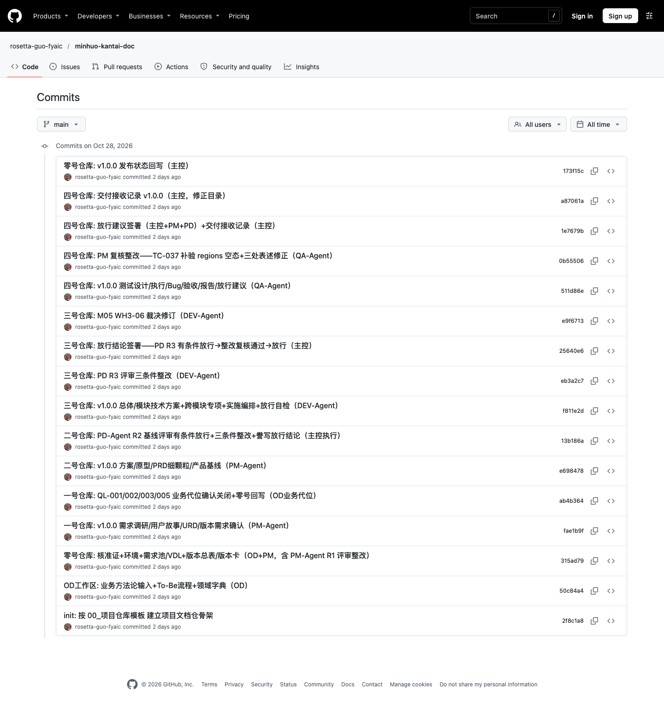

**④ 代码仓首页**——看 README：一键启动方式写在最前面（给下一个接手的人）；文件结构即三号仓库技术方案的落地——`AI_CODE_INPUT/`（研发输入汇编）→ `backend/`/`frontend/`/`database/` → `tests/`。

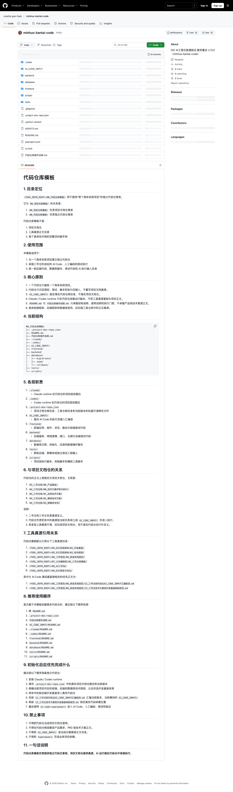

**⑤ 代码仓 release tag**——与文档仓基线 tag 呼应：文档仓冻结「设计是什么」，代码仓标记「交付的是什么」，两个 tag 之间就是本次验证定义的「版本」。

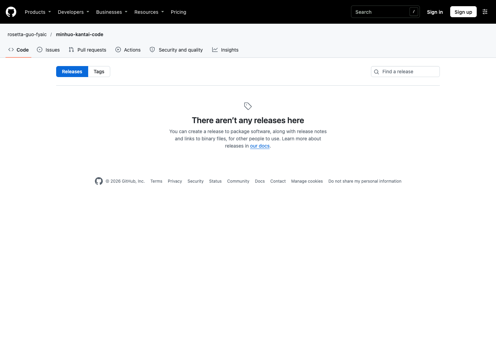

---

## 3. 结论

### 3.1 三个验证目标逐一判定

| 验证目标 | 判定 | 依据 |
| --- | --- | --- |
| ① 全链路能跑通 | **通过** | 7 段走完无跳段；每段有收口提交与留痕；版本从立项走到发布，双仓 tag 齐备 |
| ② 能发现文档断点 | **通过** | 31 项断点，每项带出处与改法（第 5 章） |
| ③ 能推演现实协作风险 | **完成** | 3 条主风险，每条有实测依据（第 6 章） |

### 3.2 对照体系六大目标

| 体系目标 | 判定 | 说明 |
| --- | --- | --- |
| 有标准 | ✅ | 每份文档按模板产出，评审用统一门禁（目录/编号/骨架/追溯/留痕五项检查） |
| 可执行 | ✅ | 蒸馏后的 Skill 链驱动全程；但原版 Skill 跨运行器不可用（EN-01） |
| 可追溯 | ⚠️ | REQ→US→FR→TC 四层编号可追；但靠人肉维护，发现 4 项追溯断点（C 类） |
| 可迭代 | ⚠️ | v1.0.0 单版本闭环完成；版本迭代码（1.1 承接、CHG、hotfix）只预留未实测 |
| 可复制 | ⚠️ | 体系在第二个运行器（ZCode）上完整重演，证明可复制；但需要先手工蒸馏 Skill，且 8 项「简化路径无合法地位」断点推高小项目复制成本 |
| 可协同 | ✅ | 五角色分工跑通，4 轮评审真实发生且有效（第 4 章） |

**成熟度口径**（CMMI 式分级，1024 会议引用）：本轮实操验证了 **L2「流程清晰」可以落地执行**，全程留痕具备 L3「流程固化」的雏形；L2→L3 的最大缺口是「追溯靠自觉、没有机器校验」。

---

## 4. 三个硬证据

### 4.1 证据一：四轮评审抓出 10 项缺陷——每项都是产出方自己发现不了的

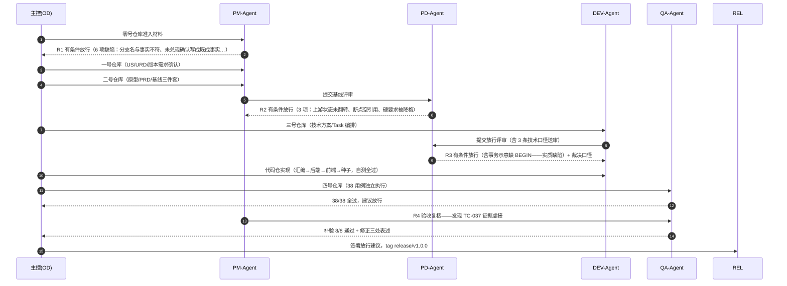

**如果没抓到会怎样**——这 10 项不是格式洁癖：

| 评审轮 | 抓出什么 | 放过去的后果 |
| --- | --- | --- |
| R1（PM） | 6 项：文档分支名与仓库实际不符；未发生的确认被写成「已确认」；3 份文档缺模板必备章节；6 份文件忘提交；OD 输出悄悄变成需求真源；一条需求无人承接 | 需求真源被污染，全链路建立在错误口径上 |
| R2（PD） | 3 项：上游「草稿」被当「已确认」冻结；断点登记空引用；硬要求被降格为「建议」 | 基线冻结失去效力 |
| R3（PD） | 3 项：**事务示意缺 BEGIN（实质代码缺陷，见 4.2）**；两处编号错标；色值出现两个「真源」 | 审计底线被破坏；后人按错编号找错文档 |
| R4（PM） | 1 项：**测试证据虚接（见 4.3）** | 「全过」里混着一个从未执行的验收点 |

**成本账**（本轮真实计量）：

| 环节 | 轮次 | Token | 耗时 |
| --- | --- | --- | --- |
| 产出轮（写文档/代码/测试） | 9 轮 | 4,445 万 | 约 107 分钟 |
| 评审与裁决轮 | 6 轮 | 293 万（占 6%） | 约 23 分钟 |
| 合计（子代理） | 15 轮 | 4,738 万 | 约 130 分钟（另含主控，全程 4~5 小时） |

AI 互评很便宜（token 占 6%）；换成真人环境，这 6 轮往返对应的是 PM/PD 的整段人力——第 5 章「评审分级」建议的依据就在这里。

### 4.2 证据二：一个会破坏审计底线的代码缺陷，被评审拦下了

三号仓库技术方案中规则修订的代码示意（原文，出自当时的跨模块专项文档）：

```python
conn = sqlite3.connect(path, isolation_level=None)   # autocommit 模式
with conn:                      # 事务边界：块内任一异常 → 自动 ROLLBACK
    conn.execute("UPDATE rule SET ...")
    conn.execute("INSERT INTO change_log ...")
```

文档同时断言「不存在规则已更新而留痕未写的中间态」。**这个断言是错的**：Python sqlite3 在 autocommit 模式下，`with conn` 只在退出时提交一次，并不会开启事务——照抄实现的话，UPDATE 和 INSERT 各自独立提交，「改了规则、丢了留痕」的中间态真实存在，而它破坏的正是本 DEMO 最核心的需求「规则修订必须自动留变化记录」（审计底线）。

PD 评审时对照 Python sqlite3 语义抓住。整改为显式 `BEGIN`、失败整体回滚；随后 QA 用「故意构造事务内失败」实测：断言规则表和留痕表**都**没有变化（`pytest 61 passed` 中含此回归项）。

**对 DIC 的意义**：AI 写的方案会自信地写下错误的安全断言，语气毫无破绽。拦住它的不是更聪明的 AI，是一双对照事实核对的眼睛。

### 4.3 证据三：AI 的测试报告声称测了、实际没测——被复核抓到

QA 交付的用例覆盖矩阵原文写着：

> FR-004｜AT-003 空区由 TC-037 空库实例 + **矩阵空行 0 显示共同覆盖**｜全 AT 覆盖

PM 复核时翻执行脚本源码，发现该脚本只打开过总览页和变化记录页，**从未打开过分地区页**——「矩阵空行 0 显示」在任何页面上都没有被观测过，「38/38 全过」里这一格是虚的。

处置全程留痕：QA 用空库实例补开分地区页，实测五行全 0、行可点击、下钻空态文案正确（补验 8/8 通过），同时修正三处文档表述并登记断点 WH4-05。下图为补验截图——看三处：空库下矩阵五行全部归零、被点击的「欧洲」行高亮、下钻区出现定版空态文案「该大区暂无结构化规则」——这正是原用例声称覆盖却从未打开过的页面。

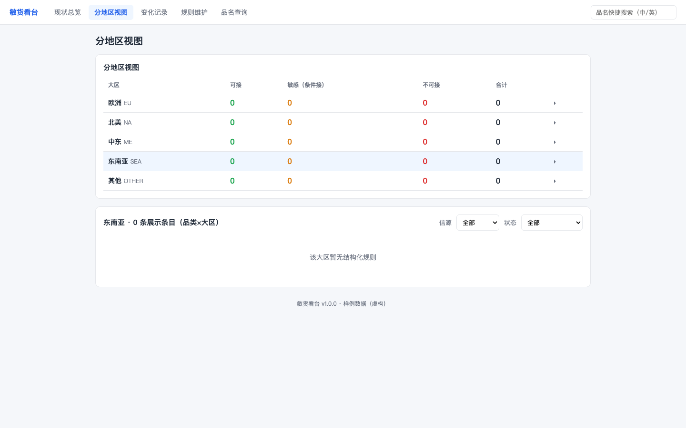

**对 DIC 的意义**：测试执行记录本身也是 AI 生成物，同样会「表述超前于事实」，且全绿报告毫无破绽。验收证据必须可复现（命令 + 原始输出 + 截图），复核人抽查执行脚本应成为标准动作。

### 4.4 交付的系统与测试结果

四个页面截图，各看一点：

**现状总览**——看三态统计卡（可接 12 绿 / 敏感 24 橙 / 不可接 15 红，合计 51 = 56 条源规则按品类×大区归并）与列表里的「多源冲突」灰色徽标：这是需求阶段「就严原则 + 冲突显式标注」两条口径在界面上的直接落地。

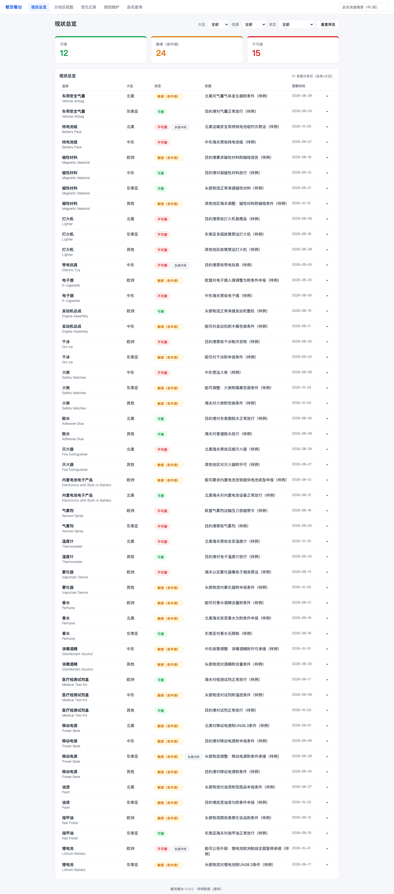

**分地区**——看矩阵行（大区 × 三态计数）与下钻明细：点「欧洲」行展开该区规则，锂电池行同时出现红色「不可接」与「多源冲突（2 源）」标注——矩阵数字与下钻明细、与总览计数、与查询结果四处一致（QA 用例 TC-008 逐处比对过）。

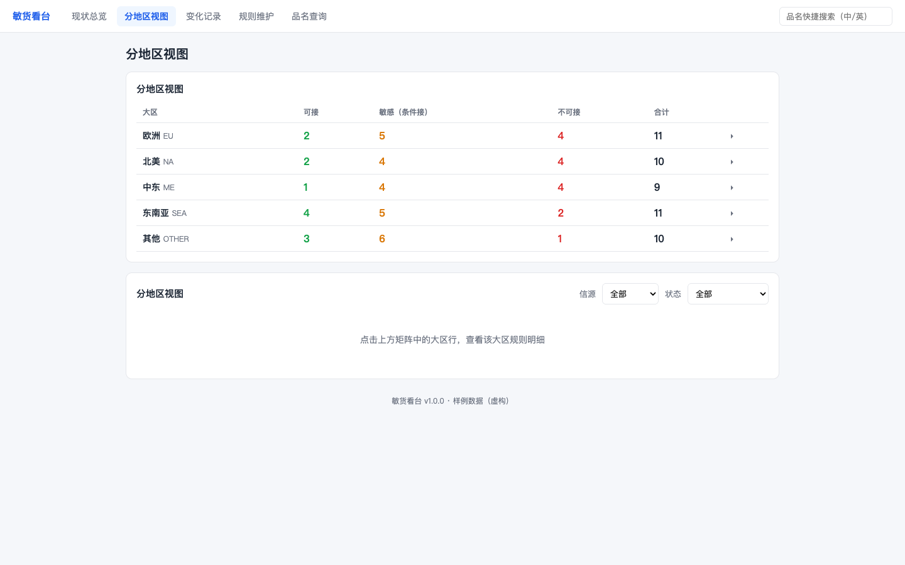

**变化记录**——看时间线要素完整性：时间、品类、大区、旧态→新态（旧态淡化、新态实色）、依据信源、操作者——这是「审计底线」需求的界面形态，每条变化可追溯。

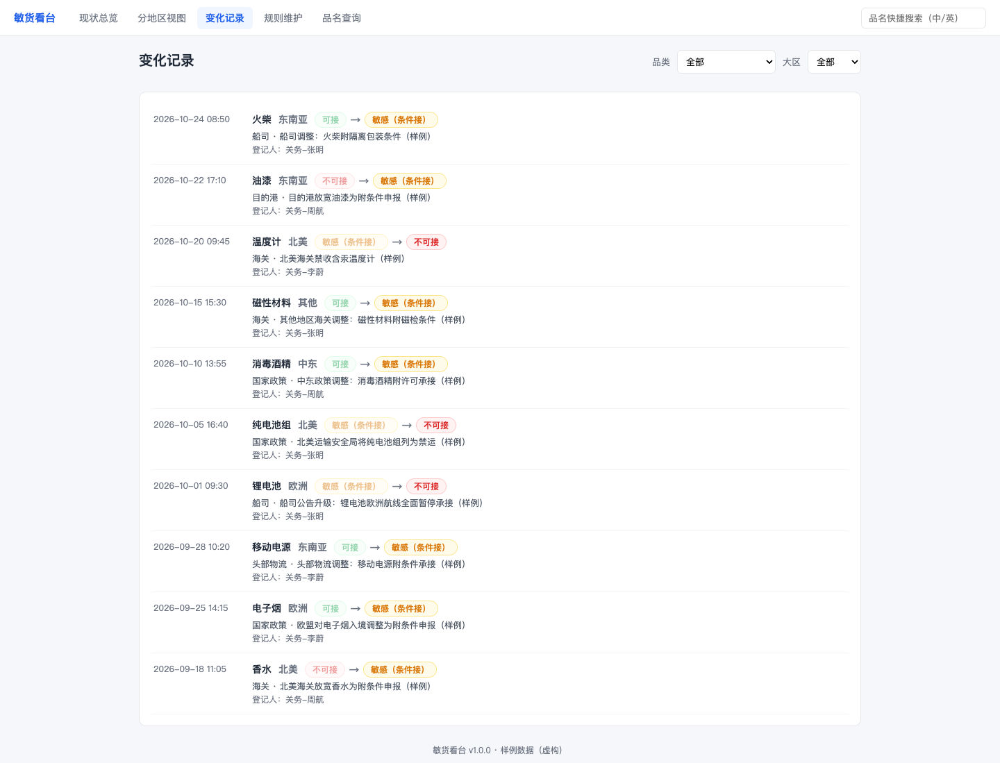

**品名查询**——看中英双向匹配（输入「电池」同时命中中英文品类）与无命中时的定版文案「未命中结构化规则，建议转关务人工判断」——后者是需求确认阶段锁死的口径，前端不得自由发挥。

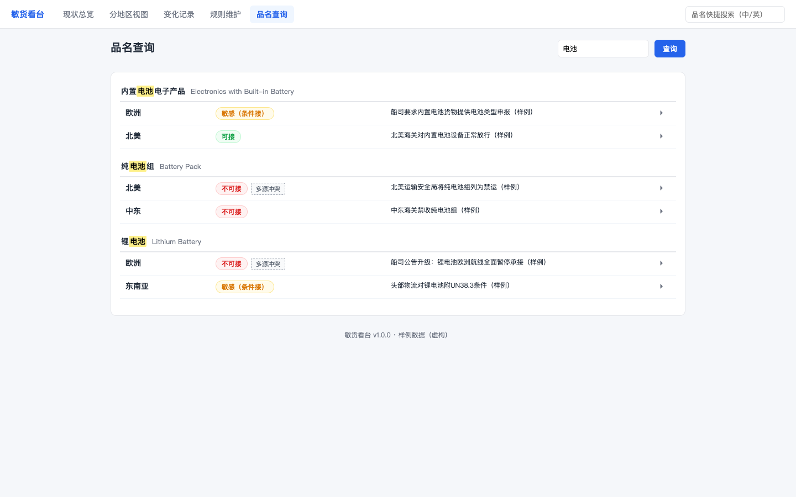

最新一轮测试原始输出（非转述）：

```text
$ uv run pytest -q
61 passed, 1 warning in 1.13s

$ bash tests/smoke_backend.sh
smoke 结果：PASS=26 FAIL=0

$ sqlite3 minhuo.db   # 种子数据
category: 22 | rule: 56 | change_log: 10
```

其余 21 张交互留证（冲突标注、409 转修订、修订后时间线自动置顶、空库三卡归零等）见 `assets/TC-*.png`，原件在文档仓 `05_四号仓库/.../02_测试执行/screenshots/`。

---

## 5. 给体系的反馈：31 项断点

完整明细（编号、出处、影响、建议）见[断点清单](00_断点清单.md)。**数字口径**：31 项 = OD 3 + 一号仓 6 + 二号仓 6 + 三号仓 6 + 四号仓 5 + 环境 5；其中 1 项（WH3-06）在验证过程中已裁决关闭，2 项（OD-02/03）属业务侧待定、挂起。

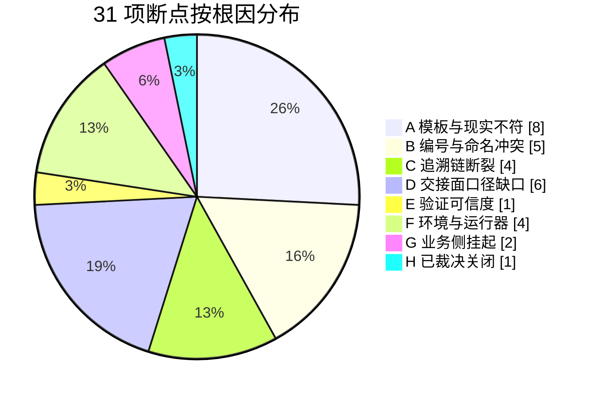

| 类 | 根因 | 代表例子 |
| --- | --- | --- |
| A. 模板与现实不符（8） | 规范按理想完整形态写，小项目没有合法简化路径 | 模板 README 引用不存在的模板文件（WH1-01）；汇编规范要求的前置产物与实际体系对不上（WH3-05） |
| B. 编号与命名冲突（5） | 缺全局编号规范，各仓模板独立演进 | 待确认清单与需求池都用 P-001，同号两义（WH1-04）；US 层与 FR 层都用 BR-*（WH2-03） |
| C. 追溯链断裂（4） | 追溯靠自觉，无机器校验 | 基线快照「引用还是复制」二义，实测发生过一次悄悄漂移（WH2-05）；阶段收口提交无工具强制（EN-03） |
| D. 交接面口径缺口（6） | 规范写到「仓」的粒度，没写到「仓与仓交接」 | 放行收口件三种说法不一（WH3-04）；405 错误是否走统一封套无人定过（WH4-01） |
| E. 验证可信度（1） | 「声称覆盖」与「实际观测」间无核对机制 | 即 4.3 节 TC-037 事件（WH4-05） |
| F. 环境与运行器（4） | 体系与特定工具链耦合 | Skill 绑死 Claude/Codex 插件机制（EN-01）；子代理会话中断丢任务、角色连续性只能靠文档真源（EN-04/05） |
| G. 业务侧挂起（2） | 需真实关务定夺 | 「敏感 vs 审核货」术语未定版（OD-02）；目的港限制只有 PPT 未结构化（OD-03） |
| H. 已裁决关闭（1） | 验证中发现并当场解决 | 种子冲突组语义矛盾（WH3-06：PD 裁决 + 整改 + 回归） |

**改法（按优先级）**：

| # | 改什么 | 治哪类 | 一句话改法 |
| --- | --- | --- | --- |
| P0-1 | 全局编号编码规范 | B 类 5 项 | 跨仓编号总表（REQ/US/FR/TC/CHG… 的前缀与作用域），工具仓统一发布 |
| P0-2 | 小项目轻量路径合法化 | A 类 8 项的根因 | 体系显式定义简化产物集（单文件方案、平铺 FR、单件放行结论），模板加简化分支 |
| P1-1 | 门禁机械化 | C 类 4 项 | doc-gatekeeper 加三类机器检查：跨仓状态一致性、git 收口、基线快照 diff 校验 |
| P1-2 | 验证证据规范 | E 类 | 测试记录必须含可复现命令 + 原始输出 + 实际观测面登记 |
| P2-1 | 确认环节防伪 | 风险 1（6.1） | 确认动作强制引用待确认件关键句；「AI 不得代签」清单扩展到全部签署点 |
| P2-2 | Skill 分层 | F 类 EN-01 | 官方把 Skill 拆成「流程规则（纯文本协议）+ 运行器适配层」两层 |
| P3 | 模板仓自检 | A 类复发 | 工具仓加 CI：README 引用的模板文件必须真实存在 |

---

## 6. 推广到 DIC 现实协作的三个风险

**风险 1：确认环节退化为橡皮章。**
本轮最严格的代位确认（逐条访谈锚点）只需分钟级；现实中产品经理每天面对几十个待确认项，大概率滑向「看一眼就确认」。1024 会议上 Tommy 批评的「提交未经消化的 AI 产出」，在工程化链路里对应的正是这些确认节点。对策即 P2-1：让「没看就确认」变难。

**风险 2：回写遗漏是静默失败。**
零号仓库的状态回写链有 6 处以上，全靠「记得去做」。本轮专门盯着回写，仍有一次被 PD 抓到「拿着草稿状态当了已确认」。现实里回写遗漏不会报错——下游按错误状态安静地继续推进。对策即 P1-1 的跨仓状态一致性机器检查。

**风险 3：验收证据的可信度没有制度保障。**
4.3 节的 TC-037 是最小样本：AI 的测试记录会声称覆盖从未观测过的东西，全绿报告毫无破绽，本轮靠 PM 复核翻脚本源码才抓到。对策即 P1-2 + 「复核抽查脚本」成为标准动作。

---

## 7. 局限

1. **没有真人**：业务方、关务、运维全部为材料或角色代位（每个代位点在文档中显式标注）；「AI 生成 + 人工确认」中「人」的那一半未经真实验证。这是本验证最大的边界。
2. **版本迭代码未实测**：v1.1 承接、基线后变更（CHG）、hotfix 判断只做了规则推演与文件预留，没有跑过一轮真实变更。
3. **单人单机**：多人 Git 并行冲突、权限分级、跨团队推广摩擦未覆盖。
4. **成本口径**：子代理消耗见 4.1；主控消耗未计量；token 为运行器上报值，未折算费用。
5. **断点不回写工具仓**：工具仓全程只读，31 项只登记不修改，留待体系维护方采纳。
6. **DEMO 属性**：数据全部虚构，系统未接任何真实信源；业务上「好不好用」不在本报告评价范围（见文首定位声明）。
7. 本报告由 AI 执笔，经独立评审子代理一轮否定性评审后重写（初版问题与评审记录在本仓 Git 历史）。

---

## 附录

### 附录 A：全链路留痕索引

| 阶段 | 产出 | 评审 | 关键提交 |
| --- | --- | --- | --- |
| OD 工作区 | 方法论输入 / To-Be 流程 / 领域字典 + OD-01~03 | — | `50c84a4` |
| 零号仓库 | 核准证 / 项目环境 / 需求池 / VDL / 版本总表 / 版本卡 | R1（PM）：有条件放行→6 项整改 | `315ad79` |
| 一号仓库 | 资料登记 / 调研结论 / 待确认 QL×6 / US-001~008 / URD / 版本需求确认 | QL 代位确认 CR-001 | `fae1b9f` `ab4b364` |
| 二号仓库 | 全局方案 / 5 页原型 / FR-001~009 / 产品基线三件套 | R2（PD）：3 条件→整改→tag `baseline/v1.0.0` | `e698478` `13b186a` |
| 三号仓库 | 总体方案 / M01~M05 / 事务专项 / Task-001~009 / 放行自检 | R3（PD）：3 条件（含 4.2 节实质缺陷）→整改→签署放行 | `f811e2d` `eb3a2c7` `25640e6` |
| 代码仓 | AI_CODE_INPUT / 后端 / 前端 / 种子 / 自测 | 按 Task 表实施，范围外零混入 | `c80ab08`→`e129939` |
| 四号仓库 | 38 用例 / 执行记录 / 21 截图 / Bug 管理 / 验收 / 放行建议 | R4（PM）：证据虚接→补验→放行签署 | `511d86e` `0b55506` `1e7679b` |
| 交付 | 交付接收记录 / 遗留移交 / 零号回写「已发布」 | — | `a87061a` `173f15c`，tag `release/v1.0.0` |

### 附录 B：截图索引（35 张，均在 `assets/`）

| 组 | 文件 | 每组证明什么 |
| --- | --- | --- |
| GitHub 产物 | `gh-01~05`、`gh-06~07` | 产物真实公开可访问；tag 载评审结论；提交史带角色署名 |
| 过程 | `shot-01`（工作区结构）`shot-02`（本地 Git 史）`shot-03`（协作链总览） | 三仓结构、版本治理、五角色分工的本地留痕 |
| 系统页面 | `shot-04~07` | 三视图 + 查询的运行状态（4.4 节逐张说明） |
| QA 留证 | `TC-029~TC-038` 共 21 张 | 38 个用例中界面路径的逐用例证据（文档仓有用例号对应关系） |

### 附录 C：缩写表

| 缩写 | 含义 |
| --- | --- |
| OD / PM / DEV / QA / PD | 数字智慧中心 / 产品经理 / 研发 / 测试 / 产品总监（本轮为五种 agent 角色） |
| 零~四号仓库 | 项目文档仓五个阶段分区：项目管理 / 需求 / 产品设计 / 技术方案 / 测试交付 |
| US / FR / TC | 用户故事 / 功能需求 / 测试用例（三层追溯编号） |
| REQ / VDL / QL | 需求编号 / 版本需求清单 / 待确认项编号 |
| CHG / AT / TD | 基线后变更编号 / 验收标准 / 技术口径决策编号 |
| R1~R4 | 四轮评审门禁（准入 / 基线 / 技术放行 / 验收复核） |
| WH / EN / OD-NN | 断点编号前缀：仓库阶段发现 / 环境发现 / OD 阶段发现 |
| L2 / L3 | 成熟度分级：流程清晰 / 流程固化（CMMI 口径，1024 会议引用） |
